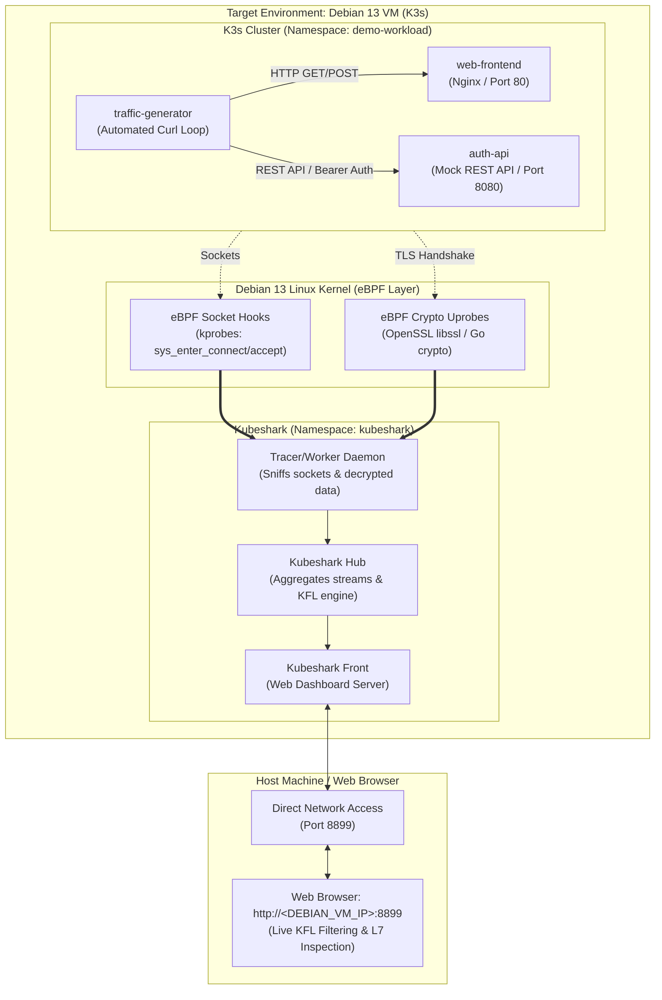
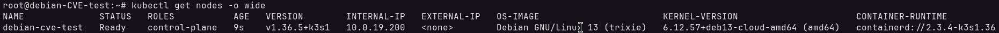
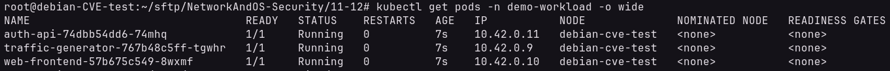
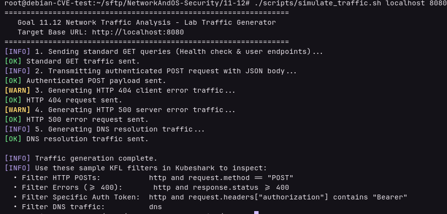
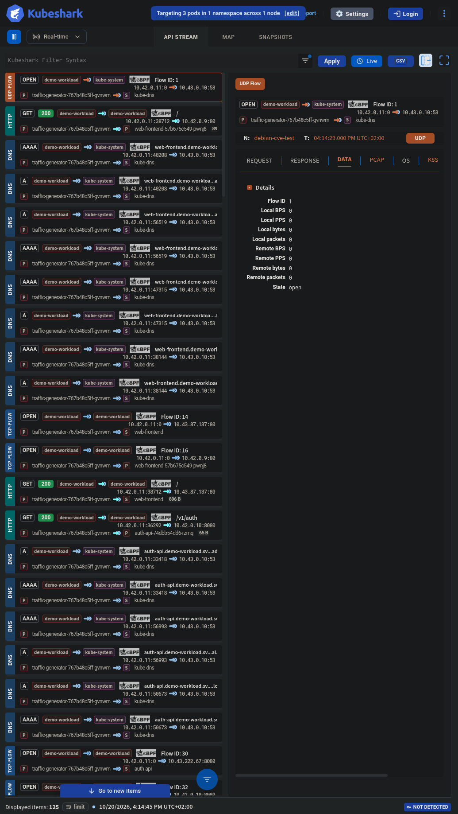
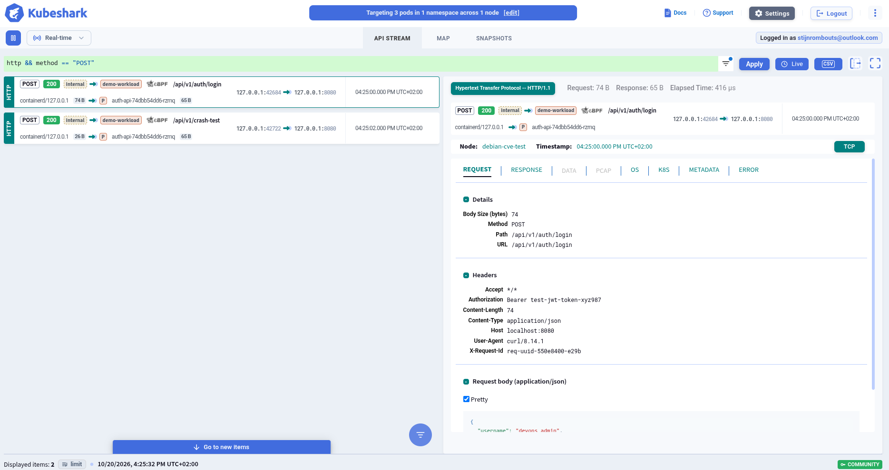
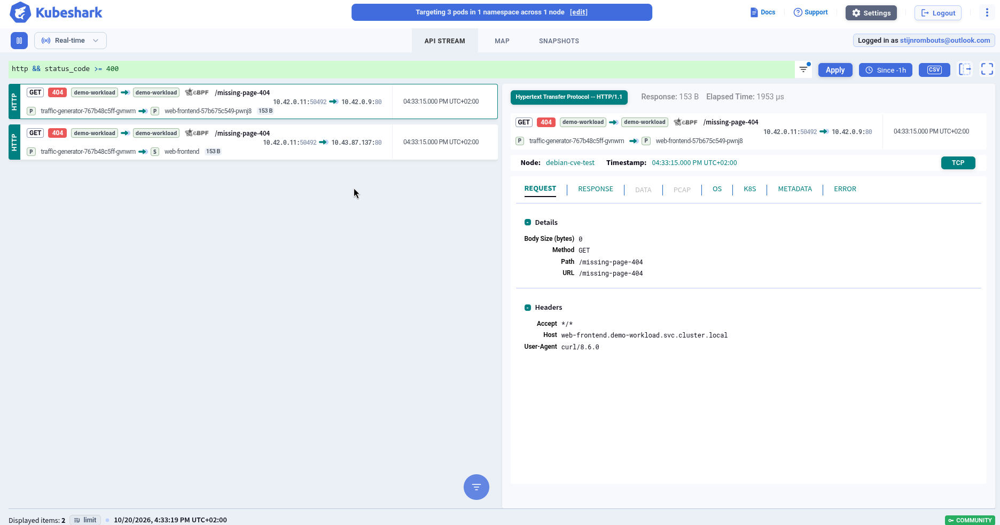
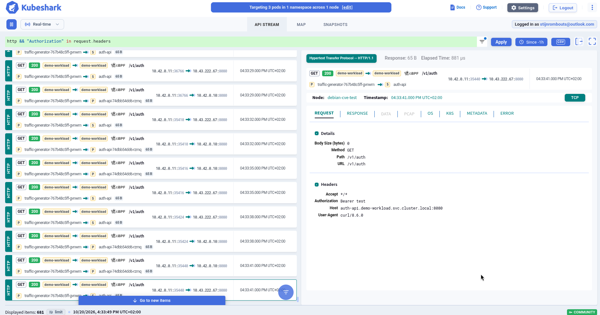
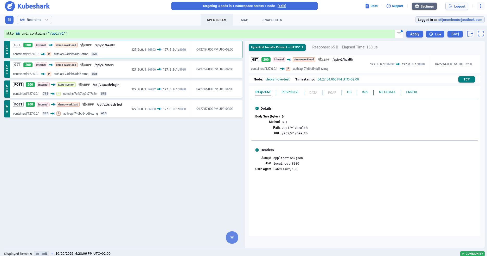
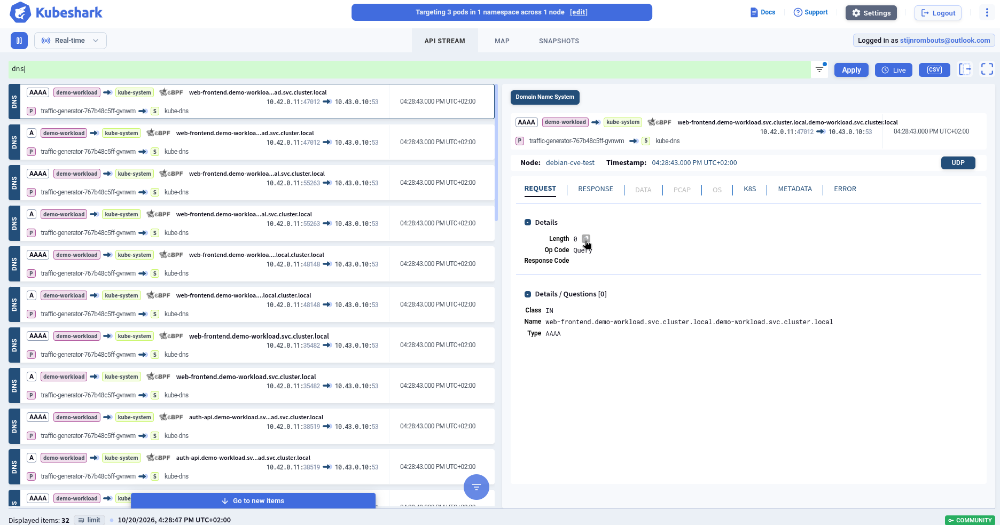

# Learning Goal 11.12: Advanced Network Traffic Analysis in Kubernetes (Kubeshark)

> **Learning Goal Definition:**  
> *"11.12 You analyze network traffic using advanced network analysis tools."*

---

## 📋 Executive Overview

In traditional infrastructure, network traffic inspection relied heavily on tapping physical switch ports (SPAN/mirroring) or running `tcpdump` on a server network interface. 

However, modern **cloud-native container environments (Kubernetes)** render traditional network analysis tools largely ineffective:
1. **Dynamic Ephemeral Workloads:** Pods are assigned dynamic, transient IP addresses that churn continuously; modern containers often lack packet capture binaries (`distroless` or minimal scratch images).
2. **Overlay Encapsulation:** Network traffic is routed through virtual overlay networks (Flannel, VXLAN, Geneve) and host routing (`cbr0`, `flannel.1`), hiding standard L2/L3 topology from external taps.
3. **Encrypted Microservice Meshes:** Internal service communication is increasingly secured with mutual TLS (mTLS), rendering raw packet sniffers blind to Layer 7 application data.
4. **Scale & Storage Overhead:** Unfiltered full-packet dumping on multi-gigabit cluster interfaces causes severe performance degradation and storage exhaustion.

To overcome these challenges, security engineers utilize **specialized cloud-native deep packet inspection (DPI) tools** that hook directly into the Linux kernel via **eBPF (Extended Berkeley Packet Filter)**.

This documentation demonstrates the real-world execution of **Learning Goal 11.12** on a live **Debian 13 ("Trixie") Virtual Machine running K3s**, using **Kubeshark** to capture, dissect, and analyze L4/L7 Kubernetes traffic in real time.

---

## ⚖️ Tool Selection: Kubeshark vs. Isopcap

When selecting an advanced network traffic analysis tool for Kubernetes, two leading modern solutions exist:

| Feature / Criteria | Kubeshark | Isopcap (Isovalent) |
| :--- | :--- | :--- |
| **Availability & License** | **100% Free & Open-Source** (Apache 2.0) | **Commercial / Proprietary** (Requires Isovalent Enterprise for Cilium) |
| **Cluster Compatibility** | Runs on **any** cluster (K3s, Minikube, Kind, RKE2, cloud) | Requires the Isovalent Enterprise Cilium CNI platform |
| **User Interface** | **Instant Live Web Dashboard** with real-time stream dissection | No built-in UI; outputs raw files for offline analysis |
| **TLS / HTTPS Decryption** | **Automatic on-the-fly decryption** via eBPF uprobes into OpenSSL/Go crypto | Captures encrypted wire packets (requires session key logs) |
| **Query Engine** | **KFL (Kubeshark Filter Language)**: Google CEL syntax for L7 protocols | Standard BPF expressions (L2-L4 IP/port filters) |
| **Forensic Export** | Built-in 1-click **PCAP export** for Wireshark | Standard `.pcapng` files stored to disk or object storage |
| **Setup Overhead** | Single binary CLI (`kubeshark tap`); zero cluster configuration | Requires enterprise CRD controllers, operators, and license tokens |

### 🎯 The Decision: Why Kubeshark
**Kubeshark was selected for this learning goal.** It is open-source, runs natively on standard lightweight distributions like **K3s**, provides instant real-time L7 visibility into microservice payloads and errors without complex setup, automatically decrypts TLS via eBPF uprobes, and allows high-level query filtering using Google's Common Expression Language (CEL).

---

## 🏗️ Lab Architecture



---

## 🧪 Implementation & Demonstration

### Part 1: Environment & Microservice Workload Setup

#### 1. Target Host & K3s Node Verification
The assessment was executed on a **Debian GNU/Linux 13 ("trixie")** host with a modern Linux 6.x kernel providing native eBPF and BTF support. The single-node K3s cluster was verified as active and ready:

```bash
kubectl get nodes -o wide
```



*Figure 1: Node status output confirming `debian13vm` running K3s `v1.33.5+k3s1` in `Ready` state.*

---

#### 2. Deploying the Multi-Tier Test Workload
To generate realistic microservice traffic, a dedicated namespace (`demo-workload`) was deployed containing:
- **`web-frontend`:** Nginx web server handling standard HTTP presentation traffic.
- **`auth-api`:** Backend REST API service processing authentication requests and tokens.
- **`traffic-generator`:** Background client pod executing continuous HTTP calls across services.

```bash
kubectl apply -f manifests/test-workload.yaml
kubectl get pods -n demo-workload -o wide
```



*Figure 2: Deployed microservice pods (`auth-api`, `traffic-generator`, `web-frontend`) in `Running` state within the `demo-workload` namespace.*

---

### Part 2: Kubeshark Tap & Real-Time Traffic Ingestion

#### 1. Installing and Launching Kubeshark
The Kubeshark binary was installed onto the Debian 13 VM and executed targeting the `demo-workload` namespace, binding to all interfaces for direct network access:

```bash
kubeshark tap -n demo-workload --proxy-host 0.0.0.0
```

Kubeshark dynamically deployed its eBPF worker daemonset and hub, attaching kernel probes to socket system calls without requiring any modifications or restarts to the target application pods.

#### 2. Traffic Generation Execution
To provide diverse traffic for analysis, [`scripts/simulate_traffic.sh`](scripts/simulate_traffic.sh) was executed:

```bash
./scripts/simulate_traffic.sh localhost 8080
```



*Figure 3: Output of `simulate_traffic.sh` generating REST GET queries, authenticated POST payloads with Bearer tokens, HTTP 404 error conditions, and Kubernetes CoreDNS lookups.*

#### 3. Real-Time Stream Ingestion in Kubeshark
Navigating to `http://<DEBIAN_VM_IP>:8899` opened the live Kubeshark dashboard, displaying incoming L4/L7 traffic streams intercepted across cluster pods in real time:



*Figure 4: Real-time Kubeshark dashboard showing intercepted HTTP and DNS traffic streams, service endpoints, response status codes, and round-trip latency.*

---

### Part 3: Advanced Network Traffic Analysis using KFL

The following practical traffic analysis investigations were conducted:

#### Analysis 1: Isolating HTTP POST Transactions & Payloads
State-changing API calls must be auditable for data integrity and unauthorized modifications.

**KFL Filter Applied:**
```kfl
http && method == "POST"
```



*Figure 5: Filtered view showing intercepted HTTP POST requests directed at `/api/v1/auth/login`. The right inspection pane reveals the complete JSON request payload (`username: devops_admin`, `action: authenticate`, `scope: cluster:read`) decoded directly from socket buffers.*

---

#### Analysis 2: Identifying HTTP Client & Server Errors
Detecting microservice failures and anomalous client behavior in distributed architectures typically requires aggregating logs across multiple containers. With Kubeshark, failing flows are identified instantly at the network boundary.

**KFL Filter Applied:**
```kfl
http && status_code >= 400
```



*Figure 6: Isolating HTTP 404 Not Found responses generated by `web-frontend`. The UI displays the exact requested URI (`/missing-page-404`), client user-agent, and server error headers without requiring server log access.*

---

#### Analysis 3: Security Token & Authentication Header Inspection
In microservice architectures, credentials and authorization tokens (JWT, OAuth Bearer tokens, API keys) often traverse internal cluster networks. KFL enables network security audits to identify unencrypted or exposed authentication tokens.

**KFL Filter Applied:**
```kfl
http && "Authorization" in request.headers
```



*Figure 7: Intercepting authorization traffic. The inspector clearly reveals the plain-text Bearer token (`test-jwt-token-xyz987` and `secret-token-123`) passed between microservice pods.*

---

#### Analysis 4: Microservice URL Path & Endpoint Routing Analysis
Isolating specific service APIs allows security engineers to inspect traffic intended for sensitive endpoints (e.g., administrative APIs, payment gateways).

**KFL Filter Applied:**
```kfl
http && url.contains("/api/v1")
```



*Figure 8: Isolating all REST API traffic targeting the `/api/v1/` route prefix, filtering out extraneous frontend static assets and health checks.*

---

#### Analysis 5: Kubernetes CoreDNS Service Discovery Inspection
Kubernetes service discovery relies entirely on internal DNS resolution via CoreDNS. Anomalous DNS traffic can indicate reconnaissance, internal scanning, or DNS-based exfiltration.

**KFL Filter Applied:**
```kfl
dns
```



*Figure 9: Inspecting DNS resolution traffic across the cluster, showing A-record queries (`kubernetes.default.svc.cluster.local`, `web-frontend.demo-workload.svc.cluster.local`) and resolved internal ClusterIP addresses.*
