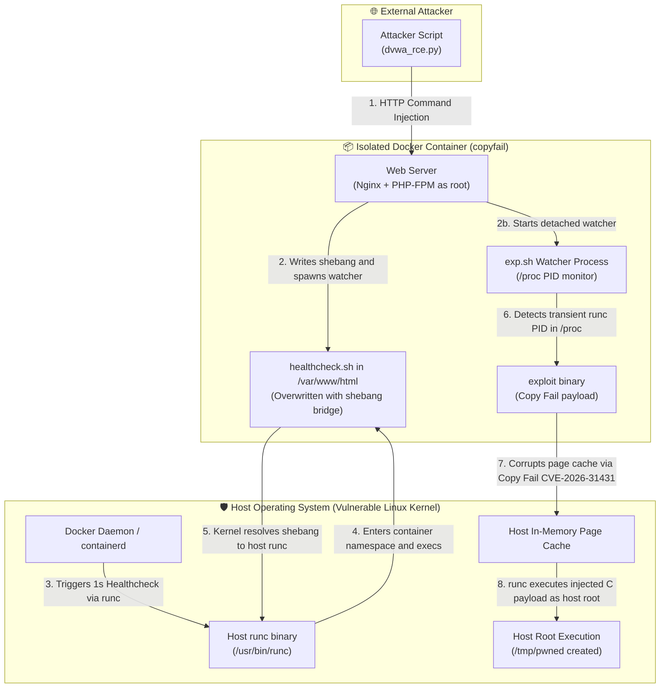
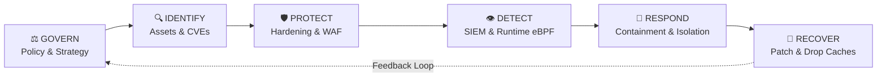

# Learning Goal 11.6: Cybersecurity Framework Association

> **Learning Goal Definition:**  
> *"11.6 You associate Cybersecurity events with the corresponding phases of a Cybersecurity framework."*

---

## 📋 Executive Overview & Scenario Context

In containerized and Linux server environments, modern cyberattacks rarely consist of a single isolated exploit. Instead, adversaries conduct **multi-stage attack chains** that traverse application layers, container boundaries, and underlying host infrastructure.

This documentation evaluates a complete full-chain attack scenario developed in the lab:
- **Demonstrated Scenario:** A web application (DVWA) running inside a Docker container, vulnerable to **Remote Code Execution (RCE)** via command injection, chained with an automated **Container Escape** via the **Copy Fail** vulnerability (**CVE-2026-31431**) exploiting Docker healthchecks to achieve root execution on the host system.
- **Framework Mapping & Analysis:**
  1. **Technical Breakdown of the PoC:** Step-by-step mechanics of the DVWA RCE, shebang bridge (`#!/proc/self/exe`), and Copy Fail pagecache corruption.
  2. **MITRE ATT&CK Framework Mapping:** Identifying adversary tactics, techniques, and procedures (TTPs) at each phase, analyzing what went wrong, and examining detection engineering for Linux containers.
  3. **NIST Cybersecurity Framework (CSF 2.0) Alignment:** Mapping the incident across **Govern**, **Identify**, **Protect**, **Detect**, **Respond**, and **Recover** to determine root causes and defense-in-depth mitigations.

---

## 🔬 Part 1: Technical Analysis & Proof-of-Concept Breakdown

The demonstration files and exploit artifacts are located in [`CVE-2026-31431-Copy-Fail-Container-Escape/`](CVE-2026-31431-Copy-Fail-Container-Escape/).



### 1. Stage 1: Web Application Remote Code Execution (`dvwa_rce.py`)
- **Vulnerability:** Damn Vulnerable Web Application (DVWA) command injection module at `security=low`.
- **Root Cause:** User-supplied input to the `ip` parameter is concatenated directly into a system ping command without sanitization or parameterization:
  ```php
  $target = $_REQUEST[ 'ip' ];
  $cmd = shell_exec( 'ping  -c 4 ' . $target );
  ```
- **Execution Mechanism:**
  The Python automation script [`dvwa_rce.py`](CVE-2026-31431-Copy-Fail-Container-Escape/dvwa_rce.py) performs automated authentication, fetches CSRF tokens, sets the security level to low, and sends injected shell commands.
- **Misconfiguration Catalyst:**
  In [`Dockerfile`](CVE-2026-31431-Copy-Fail-Container-Escape/Dockerfile), PHP-FPM is configured to run as `root` with the `-R` flag, and the health check script resides in the writable web root `/var/www/html/healthcheck.sh`. This gives the remote web attacker immediate `root` execution rights inside the container.

### 2. Stage 2: Shebang Bridge & Health Check Hijacking
Inside a container namespace, the attacker cannot access or write to `/usr/bin/runc` directly because the root filesystem is isolated via `pivot_root`/mount namespaces. To escape, the attacker requires an active file descriptor pointing to a host binary.

- **The Shebang Bridge (`#!/proc/self/exe`):**
  Docker's container healthcheck is configured in [`docker-compose-2.yml`](CVE-2026-31431-Copy-Fail-Container-Escape/docker-compose-2.yml) to execute every second:
  ```yaml
  healthcheck:
    test: ["CMD", "/var/www/html/healthcheck.sh"]
    interval: 1s
    timeout: 5s
  ```
  The exploit replaces `/var/www/html/healthcheck.sh` with a one-line shebang:
  ```bash
  echo '#!/proc/self/exe' > /var/www/html/healthcheck.sh
  ```
- **The Kernel Resolution:**
  When Docker triggers the health check, the host runtime `runc` (running as host `root`) enters the container namespace and calls `execve()` on `/var/www/html/healthcheck.sh`.
  Because the Linux kernel evaluates `#!` relative to the *executing process* (`runc`), `/proc/self/exe` resolves to the binary executing the script: the **host's `/usr/bin/runc` binary**.

### 3. Stage 3: The Copy Fail Vulnerability (CVE-2026-31431)
- **Mechanism:**
  `exp.sh` loops through `/proc/[0-9]*/exe` inside the container. When `runc` invokes the healthcheck, a transient process appears whose `/proc/$PID/exe` symlink points to `/runc`.
- The compiled `exploit` binary applies the **Copy Fail** vulnerability. Copy Fail enables writing to read-only memory mappings in the operating system's unified page cache.
- Rather than modifying the immutable binary file on disk (which would be blocked by Linux filesystem permissions), the exploit poisons the host kernel's **in-memory page cache** for `/usr/bin/runc`.

### 4. Stage 4: Execution as Host Root
- When the host daemon subsequently invokes `runc` for another healthcheck or execution task, the host kernel serves the corrupted pages from the page cache.
- The compiled payload ([`payload.c`](CVE-2026-31431-Copy-Fail-Container-Escape/payload.c) or [`payload_tty.c`](CVE-2026-31431-Copy-Fail-Container-Escape/payload_tty.c)) executes with **full host root privileges**.
- In the PoC, this creates `/tmp/pwned` on the host, writes a banner to `/root/pwned.txt`, or attaches directly to the host TTY console.

---

## 🎯 Part 2: MITRE ATT&CK Framework Mapping

The **MITRE ATT&CK** (Adversarial Tactics, Techniques, and Common Knowledge) framework organizes cyber events into chronological adversary goals (**Tactics**) and specific methods (**Techniques & Sub-techniques**).

In Linux and container security operations, mapping telemetry against the ATT&CK Matrix for Enterprise and Containers allows security teams to identify multi-stage attack chains and eliminate detection blind spots.

### 1. Attack Chain Mapping Matrix

| ATT&CK Phase / Tactic | Technique ID | Technique Name | Event / Action in PoC | Detection Data Source |
| :--- | :--- | :--- | :--- | :--- |
| **Initial Access** | [T1190](https://attack.mitre.org/techniques/T1190/) | Exploit Public-Facing Application | Sending crafted HTTP requests with injected commands via `dvwa_rce.py` | Web Server Access/Error Logs, WAF Telemetry, Network Ingress |
| **Execution** | [T1059.004](https://attack.mitre.org/techniques/T1059/004/) | Command & Scripting Interpreter: Unix Shell | PHP-FPM spawns `/bin/sh` via `shell_exec()` to run injected commands | Container Process Execution Logs, Auditd, Sysdig/Falco `execve` |
| **Discovery** | [T1057](https://attack.mitre.org/techniques/T1057/)<br>[T1613](https://attack.mitre.org/techniques/T1613/) | Process Discovery<br>Container Discovery | `exp.sh` iteratively polls `/proc/[0-9]*/exe` searching for `runc` PIDs | Container Process Monitoring, eBPF system call telemetry |
| **Privilege Escalation** | [T1068](https://attack.mitre.org/techniques/T1068/) | Exploitation for Privilege Escalation | Exploiting Copy Fail (CVE-2026-31431) to bypass kernel memory write protection | Host Kernel Logs, Memory integrity verification |
| **Defense Evasion** | [T1574](https://attack.mitre.org/techniques/T1574/)<br>[T1611](https://attack.mitre.org/techniques/T1611/) | Hijack Execution Flow<br>**Escape to Host** | Overwriting `healthcheck.sh` with `#!/proc/self/exe` and corrupting `runc` page cache to break container isolation | Host Runtime Telemetry, Container Runtime Logs (`containerd`/`dockerd`) |
| **Persistence / Execution** | [T1053.003](https://attack.mitre.org/techniques/T1053/003/) | Scheduled Task / Job: Container Healthcheck | Abusing Docker's automated 1-second recurring healthcheck to trigger host execution | Docker daemon events, Container configuration audits |
| **Impact** | [T1485](https://attack.mitre.org/techniques/T1485/) / Host Compromise | Data Manipulation / Full Host Takeover | Arbitrary execution on the host machine (`/tmp/pwned`, hijacking host root TTY) | Host Filesystem Integrity Monitoring (FIM), Syslog, Auditd |

---

### 2. What Went Wrong? (Root Cause Analysis according to ATT&CK)

Analyzing the scenario through the ATT&CK lens reveals multiple systemic security failures across different layers:

1. **Initial Boundary Failure (T1190):**
   - The application accepted untrusted user input directly into a shell interpreter.
   - Absence of an ingress Web Application Firewall (WAF) to inspect and drop command injection patterns.
2. **Container Privilege Misconfiguration (T1059 / T1611):**
   - The web application was running as `root` (UID 0) inside the container.
   - User namespaces (`userns-remap`) were disabled. Consequently, `root` inside the container maps directly to `root` on the host kernel.
3. **Insecure Application Layout & Permissions:**
   - The automated healthcheck script (`/var/www/html/healthcheck.sh`) was located within the publicly accessible and writable web root.
   - The web server user had write access to files executed by the host runtime.
4. **Host Kernel & Runtime Vulnerability (T1068 / T1611):**
   - The host ran a Linux kernel and runtime vulnerable to CVE-2026-31431 (Copy Fail), permitting memory page cache modification across namespace barriers.
5. **Detection & Visibility Blind Spot:**
   - No runtime security agent was active inside the container to detect rapid `/proc` polling, shebang modification, or access to `/proc/$PID/exe`.

---

## 🏛️ Part 3: NIST Cybersecurity Framework (CSF 2.0) Alignment

The **NIST Cybersecurity Framework (CSF 2.0)** provides a comprehensive lifecycle for cybersecurity risk management across six core functions: **Govern (GV)**, **Identify (ID)**, **Protect (PR)**, **Detect (DE)**, **Respond (RS)**, and **Recover (RC)**.



### 1. Mapping Events and Failures to NIST CSF Functions

#### 1. GOVERN (GV) - Strategy, Policy, and Oversight
- **What Went Wrong:** Lack of security governance policies regarding container supply chain integrity, container hardening standards, and strict separation between web-accessible directories and administrative scripts.
- **Remediation / Association:**
  - Establish organizational policies enforcing rootless container execution.
  - Implement minimum security baselines (CIS Docker Benchmarks, CIS Linux Benchmarks).
  - Define vulnerability management SLAs for patching host container runtimes and kernel zero-days.

#### 2. IDENTIFY (ID) - Asset Management, Risk Assessment, Vulnerability Identification
- **What Went Wrong:**
  - Failure to identify the presence of vulnerable third-party components (DVWA) and the critical host kernel/runtime vulnerability (CVE-2026-31431).
  - Failure to model the threat of container health check mechanisms as an attack bridge between container and host.
- **Remediation / Association:**
  - **Asset Inventory:** Continuous inventory of container images, host kernel versions, and runtime binaries (`runc`, `containerd`).
  - **Vulnerability Scanning:** Automated CI/CD scanning to detect known web vulnerabilities and container configuration errors.

#### 3. PROTECT (PR) - Defense-in-Depth, Safeguards, and Hardening
- **What Went Wrong:** Multiple defense layers failed simultaneously:
  - Input validation was absent at the web layer.
  - The container executed as `root` with writable root filesystem.
  - Healthcheck script was writable by the web process.
  - Host kernel lacked mitigation against pagecache manipulation.
- **Remediation / Association:**
  - **Application Protection:** Input sanitization, parameterization, and deploying a Web Application Firewall (WAF) or reverse proxy to inspect incoming traffic and block command injection patterns.
  - **Least Privilege & Isolation:**
    - Run container processes as an unprivileged user (`USER www-data`).
    - Mount the root filesystem as read-only (`read_only: true` in Docker Compose).
    - Store administrative scripts outside the web root (`/usr/local/bin/healthcheck.sh`) and make them owned by `root:root` with permissions `0555` (read & execute only).
  - **Container Isolation:**
    - Enable **User Namespaces** (`userns-remap` in `/etc/docker/daemon.json`), ensuring UID 0 in the container maps to an unprivileged UID (e.g., 100000) on the host.
    - Drop unnecessary Linux capabilities (`cap_drop: [ALL]`, adding back only required capabilities like `NET_BIND_SERVICE`).
    - Apply restrictive Seccomp profiles and AppArmor/SELinux enforcement to restrict system calls like `execve` on unfamiliar binaries.

#### 4. DETECT (DE) - Continuous Monitoring, Anomaly Detection, and Threat Visibility
- **What Went Wrong:** The rapid `/proc` polling, shebang manipulation, and subsequent pagecache corruption occurred completely unnoticed by host and container monitoring.
- **Remediation / Association:**
  - **Kernel & Runtime Monitoring:** Monitor system calls and kernel-level events in real time to identify abnormal container behavior. This capability allows the system to:
    - Detect unexpected write operations to executable scripts or configuration files invoked by the container runtime (such as healthcheck definitions).
    - Flag attempts to alter shebang lines to point back to host-level binaries (e.g., `/proc/self/exe`).
    - Observe and restrict suspicious access to `/proc/<PID>/exe` across process and namespace boundaries.
  - **Behavioral & Process Anomaly Detection:** Establish an operational baseline for containerized applications to detect deviations as they occur:
    - Alert when web server daemons spawn interactive command shells (`/bin/sh`, `/bin/bash`) or launch compiler tools.
    - Detect anomalous tight polling loops iterating through `/proc` process directories.
  - **Centralized Log Aggregation:** Ingest host audit records, container lifecycle events, and web application access logs into a centralized security monitoring system to correlate multi-stage activities across application and infrastructure layers.

#### 5. RESPOND (RS) - Incident Response, Containment, and Mitigation
- **What Went Wrong:** The attack escalated immediately from the web container to the host without any automated containment triggering.
- **Remediation / Association:**
  - **Automated Incident Response & Containment:** Upon detection of a container escape attempt or suspicious `execve` on `runc`:
    1. Automatically isolate the container network using Software-Defined Networking (SDN) or firewall rules.
    2. Freeze or kill the affected container instance (`docker stop copyfail`).
    3. Notify system administrators and security analysts with full attack timeline and affected components.
  - **Host Containment:** Quarantine the compromised host node from the cluster to prevent lateral movement across the internal SDN.

#### 6. RECOVER (RC) - Restoration, Forensics, and Continuous Improvement
- **What Went Wrong:** The host was left with a poisoned in-memory pagecache of `/usr/bin/runc`, meaning even legitimate future container executions would run attacker code until manually flushed.
- **Remediation / Association:**
  - **In-Memory Cache Flushing:** Force the host kernel to discard dirty page caches:
    ```bash
    echo 3 | sudo tee /proc/sys/vm/drop_caches
    ```
  - **Node Rebuilding:** In production, rather than attempting to clean a compromised host in-place, cordon and drain the node, perform forensic memory dumps, and redeploy a clean, patched host OS image from a trusted golden image.
  - **Post-Incident Review:** Conduct a root-cause retrospective, update threat detection rules, and verify the CI/CD pipeline prevents vulnerable configurations from deploying again.

---

## 📊 Summary Table: Integrating Attack Phases, ATT&CK, and NIST CSF

| Attack Step | Technical Event Description | MITRE ATT&CK Tactic & ID | NIST CSF Category | Key Defense / Mitigation |
| :---: | :--- | :--- | :--- | :--- |
| **1** | Remote input injection via DVWA web parameter (`dvwa_rce.py`) | **Initial Access**<br>T1190: Exploit Public-Facing App | **PROTECT** (PR.AT / PR.PS)<br>**DETECT** (DE.CM) | Input parameterization, WAF rules, web traffic anomaly detection |
| **2** | Container web server executes `/bin/sh` commands as container root | **Execution**<br>T1059.004: Unix Shell | **PROTECT** (PR.AC)<br>**DETECT** (DE.AE) | Run container as non-root (`USER www-data`), alert on shell spawned by PHP |
| **3** | Script monitors `/proc` to catch periodic healthcheck executions | **Discovery**<br>T1057: Process Discovery | **DETECT** (DE.CM) | Runtime process & system call monitoring detecting rapid `/proc` enumeration |
| **4** | Attacker overwrites `healthcheck.sh` with `#!/proc/self/exe` | **Defense Evasion**<br>T1574: Hijack Execution Flow | **PROTECT** (PR.DS)<br>**DETECT** (DE.CM) | Read-only container rootfs, immutable scripts outside web root |
| **5** | Host `runc` invokes script; kernel resolves path to host runtime binary | **Privilege Escalation**<br>T1611: Escape to Host | **PROTECT** (PR.AC) | Docker User Namespaces (`userns-remap`), Seccomp/AppArmor isolation |
| **6** | Exploit corrupts host memory page cache via Copy Fail (CVE-2026-31431) | **Privilege Escalation**<br>T1068: Exploitation for PrivEsc | **IDENTIFY** (ID.RA)<br>**PROTECT** (PR.MA) | Kernel security patching, memory protection mechanisms |
| **7** | Subsequent healthcheck executes payload as host root (`/tmp/pwned`) | **Impact / Execution**<br>Full Host Compromise | **RESPOND** (RS.AN / RS.MI)<br>**RECOVER** (RC.RP) | Host isolation, flushing host pagecache (`drop_caches`), node reimaging |

---

## 📚 References & Resources

- **Lab Proof-of-Concept:** [`CVE-2026-31431-Copy-Fail-Container-Escape/`](CVE-2026-31431-Copy-Fail-Container-Escape/)
- **MITRE ATT&CK Matrix for Containers:** [https://attack.mitre.org/matrices/enterprise/containers/](https://attack.mitre.org/matrices/enterprise/containers/)
- **NIST Cybersecurity Framework 2.0:** [https://www.nist.gov/cyberframework](https://www.nist.gov/cyberframework)
- **Copy Fail Research & Vulnerability Details:** [https://copy.fail/](https://copy.fail/)
