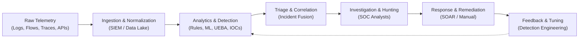
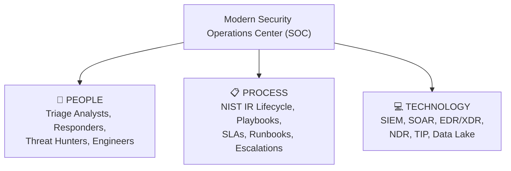
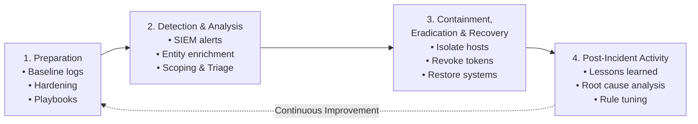
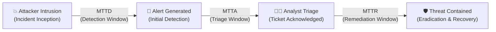
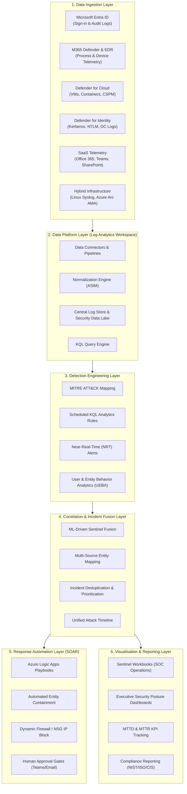

# Learning Goal 11.7: Role and Components of a Security Operations Center (SOC)

> **Learning Goal Definition:**  
> *"11.7 You understand the role and components of a Security Operation Center."*

---

## 📋 Executive Overview

A **Security Operations Center (SOC)** is the centralized organizational and technical command post responsible for monitoring, detecting, analyzing, and responding to cybersecurity incidents across an enterprise's information systems. As enterprise architectures transition from traditional perimeter-bound networks to hybrid and multi-cloud environments, the role and technical architecture of the SOC have fundamentally transformed.

This report provides an in-depth exploration of modern Security Operations Centers:
1. **Theoretical Foundations:** Core mission, organizational structures, the fundamental triad of **People, Process, and Technology**, incident response lifecycles, and key operational metrics (MTTD, MTTR).
2. **Case Study & Architectural Deep Dive:** A comprehensive architectural evaluation of a **Cloud-Native SOC platform powered by Microsoft Sentinel**, based on the enterprise reference architecture by [Serge K.S. Fumey](https://sergeksfumey.com/projects/cloud-native-soc/).
3. **Operational Mechanics & Trade-offs:** Detailed analysis of multi-stage attack correlation, detection engineering using KQL, SOAR automation risks with human-in-the-loop gates, telemetry cost optimization, and hybrid monitoring via Azure Arc.
4. **Framework Alignment:** Mapping SOC workflows to **NIST SP 800-61**, **NIST CSF 2.0**, and the **MITRE ATT&CK** matrix.

---

## 🏛️ Part 1: Theoretical Foundations of a Security Operations Center

### 1. The Core Mission of a SOC

The primary objective of a Security Operations Center is to maintain continuous situational awareness, minimize adversary dwell time, and mitigate business impact from cyber incidents. 

Historically, security monitoring operated on static perimeter defenses (firewalls, signature-based IDS/IPS). Modern threat environments—characterized by advanced persistent threats (APTs), credential stuffing, supply-chain exploits, and cloud-workload attacks—require an **assume-breach** mentality. The modern SOC operates not merely as an alert-monitoring facility, but as an active detection and response engine.



---

### 2. The Core Triad: People, Process, and Technology

An effective SOC cannot rely on technology alone. Sustainable security operations depend on the balanced synergy between three interconnected pillars:



#### A. People (Roles, Responsibilities, and Tier Hierarchy)

Traditional and modern SOCs organize human capital across tiered specializations to optimize cognitive workload and prevent analyst burnout:

| Role / Tier | Key Responsibilities | Primary Tools Used | Focus Horizon |
| :--- | :--- | :--- | :--- |
| **Tier 1: Triage Analyst** | Continuous alert queue monitoring, initial alert validation, false-positive elimination, incident ticket creation, initial containment according to standard runbooks. | SIEM Alert Queue, Ticketing system (ServiceNow/Jira), Basic EDR consoles. | Real-time (Minutes to hours) |
| **Tier 2: Incident Responder / Investigator** | Deep-dive forensic investigation, root cause analysis (RCA), attack blast radius assessment, containment coordination, lateral movement tracking, remediation execution. | Advanced EDR/XDR, Memory & Disk Forensics, Network Packet Analyzers (Wireshark), Log Analytics. | Hours to days |
| **Tier 3: Threat Hunter & Malware Specialist** | Proactive hypothesis-driven hunting for undetected threats, adversary emulation, reverse-engineering malware, identifying coverage blind spots. | Threat Intelligence Platforms (TIP), Custom Python/Jupyter scripts, Graph Analytics, Sandboxes (Cuckoo, Any.Run). | Days to weeks |
| **Detection Engineer** | Translating threat intelligence into actionable detection logic (KQL, Sigma, YARA, Snort), tuning existing rules to eliminate alert fatigue, automating detection CI/CD. | SIEM Analytics engines, Git repositories, Detection-as-Code pipelines, ATT&CK Navigator. | Continuous lifecycle |
| **SOC Manager / Lead** | Operations management, tracking operational SLAs/KPIs, shift scheduling, executive crisis communication, tool procurement, vendor relations. | Executive Dashboards, Workbook KPIs, Risk Registers, Compliance reports. | Strategic & Governance |

#### B. Process (Standardization and Incident Response Lifecycles)

Standardized processes ensure that incident handling is repeatable, forensically sound, and compliant with regulatory mandates. The SOC aligns its operational runbooks with standardized frameworks such as **NIST SP 800-61 Rev. 2** (Computer Security Incident Handling Guide):



1. **Preparation:** Establishing data collection rules, configuring log sources, training personnel, and creating automated response playbooks.
2. **Detection & Analysis:** Identifying deviations from normal baselines, correlating disparate alerts across identity and endpoint streams, and validating incident veracity.
3. **Containment, Eradication & Recovery:**
   - *Short-term Containment:* Isolating affected machines, disabling compromised user accounts, blocking malicious IPs at firewalls/NSGs.
   - *Eradication:* Removing rootkits, terminating malicious C2 sessions, eliminating scheduled tasks and persistence mechanisms.
   - *Recovery:* Restoring clean backups, validating system integrity, rotating credentials, and re-attaching workloads to production.
4. **Post-Incident Activity (Lessons Learned):** Analyzing the breakdown in controls, documenting the timeline, and feeding indicators back into the detection engineering cycle.

#### C. Technology (The Core SOC Tech Stack)

The technological foundation of a modern SOC consists of integrated systems designed to ingest, process, correlate, and act upon telemetry:

* **SIEM (Security Information and Event Management):** Central repository that aggregates logs across the entire digital estate, normalizes schema formats (e.g., ASIM, CEF), evaluates detection rules, and generates correlated alerts.
* **SOAR (Security Orchestration, Automation, and Response):** Automation engine that executes scripted playbooks via API integrations, eliminating repetitive manual analyst steps (e.g., virus total lookups, IP blocking, ticket creation).
* **EDR / XDR (Endpoint / Extended Detection and Response):** High-fidelity host sensors that record low-level kernel events, process trees, network sockets, and file system modifications, providing remote isolation and live response capabilities.
* **NDR (Network Detection and Response):** Passive network monitoring capturing flow records (NetFlow/IPFIX) and raw packet analysis to spot unmanaged devices, beaconing behavior, and lateral movement.
* **TIP (Threat Intelligence Platform):** Feeds of known malicious indicators of compromise (IOCs), adversary TTPs (Tactics, Techniques, and Procedures), and vulnerability advisories ingested via standards such as STIX/TAXII.
* **Security Data Lake:** Cost-effective long-term storage (e.g., Azure Blob Storage, AWS S3) for petabytes of raw compliance logs, allowing historical retrospectives and ad-hoc hunting without driving up high-performance SIEM indexing costs.

---

### 3. Key Operational Performance Metrics (KPIs)

To evaluate efficiency and operational health, a SOC tracks quantifiable metrics:



* **MTTD (Mean Time to Detect):** The average time elapsed from when an adversary breaches the environment to the moment the security platform alerts the SOC. A low MTTD indicates strong detection engineering and broad telemetry coverage.
* **MTTA (Mean Time to Acknowledge):** The average time from alert generation until a Tier 1/2 analyst picks up the ticket and begins active triage.
* **MTTR (Mean Time to Respond / Remediate):** The average duration from alert triage to the successful containment and neutralization of the threat.
* **Alert-to-Incident Ratio & False Positive Rate:** The percentage of generated alerts that represent benign operational activity versus genuine security incidents. High false-positive rates trigger **alert fatigue**, leading analysts to overlook critical warnings.
* **Dwell Time:** The complete window of opportunity during which an attacker remains undetected inside the target environment before expulsion.

---

## 🔍 Part 2: Case Study — Cloud-Native SOC Architecture with Microsoft Sentinel

*Based on the reference architecture by [Serge K.S. Fumey: Cloud-Native Security Operations Center with Microsoft Sentinel](https://sergeksfumey.com/projects/cloud-native-soc/).*

### 1. Context & Business Drivers

Modern enterprises operate in a decentralized paradigm: cloud infrastructure (Azure, AWS), Software-as-a-Service (Microsoft 365, Salesforce), hybrid identities (Entra ID, on-prem Active Directory), and distributed endpoints.

Traditional, on-premises SIEM architectures fail in this environment due to:
* **Fragmented Visibility:** Disconnected point solutions generate siloed alerts without cross-domain correlation.
* **Scalability Bottlenecks:** On-premises hardware appliances cannot handle sudden surges in log volume without complex storage expansions.
* **High Operational Friction:** Manual triage across separate dashboards inflates MTTD to 24–72 hours and MTTR to 4–8 hours.
* **Static Rule Inadequacy:** Simple threshold alerts fail against multi-stage adversary campaigns that exploit identity, endpoint, and cloud infrastructure simultaneously.

The **Cloud-Native SOC** design solves these challenges by combining **Microsoft Sentinel** (cloud SIEM/SOAR), **Azure Log Analytics**, **Microsoft Defender XDR**, and **Azure Logic Apps** into a unified, serverless security operations platform.

---

### 2. The 6-Layer Cloud-Native SOC Architecture

The reference design decomposes the security operations platform into six functional architectural layers:



---

### 3. Deep Dive into the 6 Architectural Layers

#### Layer 1: Data Ingestion Layer
The ingestion layer establishes telemetry pipelines from every attack surface in the hybrid enterprise using native cloud connectors:
- **Identity Telemetry (Entra ID):** Ingests interactive/non-interactive sign-ins, audit logs, service principal operations, conditional access evaluations, and identity risk detections.
- **Endpoint & Workload Telemetry (Defender for Endpoint & Cloud):** Collects deep operating system telemetry (process creation, network connections, file writes, kernel modules) from Windows and Linux workloads.
- **Hybrid Infrastructure (Syslog & Azure Monitor Agent - AMA):** Bridges on-premises Linux and Windows servers to the cloud SIEM via **Azure Arc** and AMA, forwarding Syslog/auth logs to Sentinel without complex VPN log concentrators.

#### Layer 2: Data Platform Layer
Powered by **Azure Log Analytics Workspace**:
- **Unified Security Store:** All logs are indexed into structured tables (`SigninLogs`, `DeviceProcessEvents`, `Syslog`, `SecurityAlert`, `AzureActivity`).
- **Advanced Security Information Model (ASIM):** Normalizes telemetry into industry-standard schemas so queries can target normalized fields (`TargetUserName`, `DvcIp`) regardless of source vendor.
- **Cost-Optimized Retention:** Supports 90 days to 2 years of interactive high-performance KQL search, with automated archiving to cold data storage for multi-year regulatory compliance.

#### Layer 3: Detection Engineering Layer
Rather than static signatures, detections are coded in **Kusto Query Language (KQL)** and aligned with **MITRE ATT&CK** tactics:

```kql
// Example Custom KQL Detection Rule: Impossible Travel + Suspicious Host Execution
let timeframe = 1h;
let RiskyUsers = SigninLogs
| where TimeGenerated >= ago(timeframe)
| where ResultType == 0 // Successful login
| extend LocationDetails = parse_json(LocationDetails)
| summarize DistinctLocations = dcount(tostring(LocationDetails.countryOrRegion)) by UserPrincipalName
| where DistinctLocations > 1;
RiskyUsers
| join kind=inner (
    DeviceProcessEvents
    | where TimeGenerated >= ago(timeframe)
    | where FileName in~ ("curl", "wget", "nc", "bash", "powershell.exe")
    | where ProcessCommandLine has_any ("base64", "http://", "https://", "chmod +x")
) on $left.UserPrincipalName == $right.AccountName
| project TimeGenerated, UserPrincipalName, DeviceName, FileName, ProcessCommandLine, DistinctLocations
```

#### Layer 4: Correlation & Incident Fusion Layer
Individual security products generate thousands of disjointed alerts daily. Sentinel's **Machine Learning Fusion Engine** and **Entity Mapping** correlate these disparate signals into a single unified incident based on shared entities:
- **Entity Identification:** IP addresses, User Accounts, Hostnames, URLs, and File Hashes are extracted and linked.
- **Incident Reduction:** Instead of forcing an analyst to investigate 20 distinct alerts, Sentinel consolidates them into a single incident with an end-to-end chronological timeline.

#### Layer 5: Response Automation Layer (SOAR)
Automates repetitive remediation tasks through **Azure Logic Apps** playbooks:
- **Incident Enrichment:** When an incident triggers, the playbook automatically queries VirusTotal, AlienVault OTX, and Entra ID user manager attributes, appending the findings directly to the incident notes.
- **Immediate Containment:** Isolates infected host machines via Defender EDR API, revokes active OAuth refresh tokens, and blocks malicious egress IPs on network firewalls.
- **Safety Governance:** Enforces **Human-in-the-Loop approval gates** via Microsoft Teams adaptive cards before executing high-impact actions (e.g., locking executive accounts or isolating production database servers).

#### Layer 6: Visualisation & Reporting Layer
Implemented through **Microsoft Sentinel Workbooks**:
- **SOC Operations Dashboard:** Visualizes active queues, analyst workload distributions, and open incident aging.
- **Executive Security Posture:** Maps overall telemetry coverage to NIST CSF categories, displays Defender Secure Score progression, and measures operational KPIs (MTTD and MTTR reduction).

---

### 4. End-to-End Walkthrough: Multi-Stage Attack Correlation Scenario

The true power of a cloud-native SOC lies in its ability to reconstruct complex, multi-stage kill chains that traverse different domains. The case study illustrates a complete attack scenario that would bypass isolated security tools:

```mermaid
sequenceDiagram
    autonumber
    actor Attacker as External Adversary
    participant User as Target Employee
    participant M365 as Exchange Online (M365)
    participant EDR as Host Endpoint (Defender EDR)
    participant IdP as Entra ID (Identity)
    participant Cloud as Azure Cloud Infrastructure
    participant Sentinel as Microsoft Sentinel
    participant SOAR as Logic App Playbook
    participant SOC as SOC Tier 1/2 Analyst

    Attacker->>User: Spear-phishing email with malicious attachment
    M365->>Sentinel: Ingests alert - Phishing Attachment Delivered
    User->>EDR: Opens attachment and macro spawns PowerShell C2 beacon
    EDR->>Sentinel: Ingests alert - Suspicious Process Execution (PowerShell base64)
    Attacker->>IdP: Harvests credentials and runs password spray
    IdP->>Sentinel: Ingests event - Risky Sign-in / Impossible Travel
    Attacker->>Cloud: Logs into Azure Portal and attempts privilege escalation
    Cloud->>Sentinel: Ingests audit log - Suspicious Role Assignment Created
    
    rect rgb(30, 40, 60)
        Note over Sentinel: Sentinel Fusion Engine correlates all 4 alerts<br/>by UserPrincipalName and Host IP into single Incident #1042
    end
    
    Sentinel->>SOAR: Triggers Automated Containment Playbook
    SOAR->>EDR: Automatically isolates host machine from network
    SOAR->>IdP: Automatically revokes user refresh tokens
    SOAR->>SOC: Dispatches Teams alert with approval gate - Disable User Account?
    SOC->>SOAR: Analyst clicks Approve on Mobile or Teams
    SOAR->>IdP: Disables compromised user account
    SOC->>Sentinel: Completes investigation and closes Incident #1042
```



#### Attack Stage Progression vs Detection Telemetry

| Stage | Adversary Action | Detection Source | Correlated Signal in Sentinel |
| :---: | :--- | :--- | :--- |
| **1** | Phishing email delivered with malicious payload | Microsoft 365 Connector | `OfficeActivity` & `SecurityAlert` (Phishing delivered) |
| **2** | User executes macro; initial reverse shell spawned | Defender for Endpoint | `DeviceProcessEvents` (Encoded command line execution) |
| **3** | Credential harvesting and external login from unexpected country | Microsoft Entra ID | `SigninLogs` (Impossible travel + Anonymous IP) |
| **4** | Attacker probes internal Active Directory domain | Defender for Identity | `SecurityAlert` (Kerberoasting / reconnaissance) |
| **5** | Attacker accesses Azure Resource Manager to dump secrets | Azure Activity Connector | `AzureActivity` (Unauthorized KeyVault read access) |
| **Result** | **Full Attack Chain Correlated** | **Sentinel Multi-Domain Fusion** | **Single High-Severity Incident with unified timeline** |

---

### 5. Operational Targets & Efficiency Benchmarks

The cloud-native architecture directly transforms operational SOC metrics:

| Metric | Traditional Fragmented Approach | Cloud-Native Sentinel Architecture | Real-World Operational Impact |
| :--- | :--- | :--- | :--- |
| **Mean Time to Detect (MTTD)** | **24 – 72 hours** (Manual log review) | **< 1 hour** for high-severity incidents | Adversary is caught before achieving lateral movement or exfiltration. |
| **Mean Time to Respond (MTTR)** | **4 – 8 hours** (Manual ticket escalation) | **< 30 minutes** (With SOAR playbooks) | Compromised credentials and endpoints are contained before spread. |
| **False Positive Rate** | **High (> 40%)** (Generic untuned alerts) | **< 10%** (Tuned KQL behavioral baselines) | Drastically reduces analyst fatigue and burnout. |
| **Correlation Capability** | **Manual / Disjointed** | **Automated Multi-Source Fusion** | Reconstructs the entire attack chain across cloud, host, and identity. |
| **Threat Hunting** | **Ad-hoc / Sporadic** | **Structured Weekly Sprints** | Proactive discovery of zero-days and stealthy persistence mechanisms. |

---

## ⚖️ Part 3: Engineering Realities, Trade-offs & Limitations

Deploying and operating a cloud-native SOC introduces specific architectural trade-offs that security engineers must manage:

### 1. Ingestion Pricing vs Telemetry Fidelity
* **The Challenge:** Microsoft Sentinel and Log Analytics price ingestion on a **per-gigabyte (GB)** model. Ingesting full, uncompressed logs (such as verbose Linux auditd, DNS debug logs, or full firewall packet traces) across thousands of nodes generates massive monthly costs.
* **Mitigation Strategy:**
  - Implement **Data Collection Rules (DCRs)** at the Azure Monitor Agent level to filter out noisy event IDs (e.g., Windows Event ID 4688 without command line auditing) at the endpoint before transmission.
  - Utilize **Commitment Tiers** (e.g., 100 GB/day, 500 GB/day) to secure 30–50% discounts over pay-as-you-go rates.
  - Route non-security operational logs to **Basic Logs** or raw Azure Blob Storage tables for low-cost querying.

### 2. Detection Rule Tuning Cycles (The 30–90 Day Stabilization Curve)
* **The Challenge:** Off-the-shelf detection rules produce excessive false positives when initially deployed in enterprise environments with unique legacy software or custom developer scripts.
* **Mitigation Strategy:** SOC teams must enforce a mandatory **30- to 90-day tuning lifecycle**:
  1. *Audit / Staging Mode:* New analytics rules run in staging without generating analyst alerts.
  2. *Baseline Comparison:* Analyze benign triggers and add whitelist filters (e.g., excluding approved maintenance service accounts).
  3. *Production Promotion:* Enable alert generation only after the false-positive rate drops below 5%.

### 3. SOAR Automation Risk & "Blast Radius"
* **The Challenge:** Over-eager automation can cause severe business disruption. For example, an automated playbook that terminates processes or disables user accounts based on a false-positive detection could bring down an enterprise billing server or lock out the CEO during financial closing.
* **Mitigation Strategy:**
  - Implement **Approval Gates** (via Microsoft Teams or Outlook actionable messages) for any disruptive action (account locking, firewall IP blocks, host isolation).
  - Restrict fully autonomous SOAR execution strictly to non-destructive actions (e.g., threat intelligence enrichment, log bundling, notifying on-call responders).

### 4. Hybrid Visibility & The Azure Arc Prerequisite
* **The Challenge:** A cloud SIEM provides zero visibility into legacy on-premises servers unless telemetry bridges are properly configured.
* **Mitigation Strategy:** Deploy **Azure Arc** as the central control plane across all on-premises Linux and Windows servers, enforcing automated deployment of the Azure Monitor Agent (AMA) via Azure Policy to prevent monitoring blind spots.

---

## 📊 Part 4: Comparative Synthesis — Legacy vs Modern Cloud-Native SOC

| Characteristic | Traditional On-Premises SOC | Modern Cloud-Native SOC (Sentinel) |
| :--- | :--- | :--- |
| **Primary Architecture** | Bare-metal appliances, dedicated storage SANs, on-prem hardware clusters | Serverless, cloud-native (Azure Log Analytics / Elastic compute) |
| **Perimeter Model** | Network-centric (Firewalls, VPN concentrators, DMZ boundary) | Identity-centric & Zero Trust (Entra ID, conditional access, workload APIs) |
| **Log Ingestion & Scalability** | Fixed capacity; storage expansions require capital hardware purchases | Elastic scale; auto-scales with telemetry volume surges without downtime |
| **Detection Approach** | Static signature matching, threshold alerts (e.g., 5 failed logins) | Behavioral baselines, machine learning fusion, KQL correlation rules |
| **Response Capability** | Manual; analyst copies IPs to firewall consoles and emails sysadmins | Automated SOAR playbooks (Azure Logic Apps), API-driven containment |
| **Hybrid & Multi-Cloud** | Complex log shippers, reverse proxies, and VPN tunnels required | Native multi-cloud connectors (AWS, GCP, Azure) and Azure Arc agents |
| **Maintenance Burden** | High; OS patching, database indexing, disk array management, backup maintenance | Minimal; managed PaaS/SaaS service maintained by cloud provider |

---

## 🎯 Conclusion & Key Takeaways

1. **The SOC is an Ecosystem, Not a Single Tool:** A successful Security Operations Center relies equally on skilled **People** (Tier 1–3 analysts, detection engineers), standardized **Processes** (NIST SP 800-61 incident response lifecycles), and integrated **Technology** (SIEM, SOAR, EDR, TIP).
2. **Centralized Correlation is Indispensable:** Modern adversaries execute attacks across multiple vectors—phishing email, local host execution, identity impersonation, and cloud resource tampering. Isolated security tools fail to detect these multi-stage campaigns. Centralized SIEMs with ML-driven fusion (like Microsoft Sentinel) are essential to reconstruct the complete attack narrative.
3. **Detection Engineering Requires Dynamic Code:** Static alert signatures cannot keep pace with novel threats. Modern SOCs employ detection engineers who write behavioral logic (KQL) mapped to the **MITRE ATT&CK** framework, continuously tuning rules to balance detection sensitivity against alert fatigue.
4. **Automation Must Be Balanced with Human Oversight:** SOAR drastically compresses MTTR from hours to minutes. However, high-impact containment actions must incorporate approval gates to mitigate the operational risk of false positives.
5. **Cost Optimization is a Core Security Function:** Because cloud SIEMs operate on consumption pricing, security engineers must actively manage data pipelines—using filtering rules, commitment tiers, and tiered storage—to maintain high telemetry fidelity without budget overrun.

---

## 📚 References & Further Reading

* Fumey, S. K. S. (2026). *Cloud-Native Security Operations Center (SOC) with Microsoft Sentinel*. Case Study CS 05. Available at: [https://sergeksfumey.com/projects/cloud-native-soc/](https://sergeksfumey.com/projects/cloud-native-soc/)
* National Institute of Standards and Technology (NIST). (2012). *Computer Security Incident Handling Guide* (NIST Special Publication 800-61 Revision 2).
* National Institute of Standards and Technology (NIST). (2024). *The NIST Cybersecurity Framework (CSF) 2.0*.
* MITRE Corporation. (2026). *MITRE ATT&CK Enterprise Matrix*. Available at: [https://attack.mitre.org/](https://attack.mitre.org/)
* Microsoft Learn. (2026). *Microsoft Sentinel Documentation & ASIM Architecture*. Microsoft Corporation.

